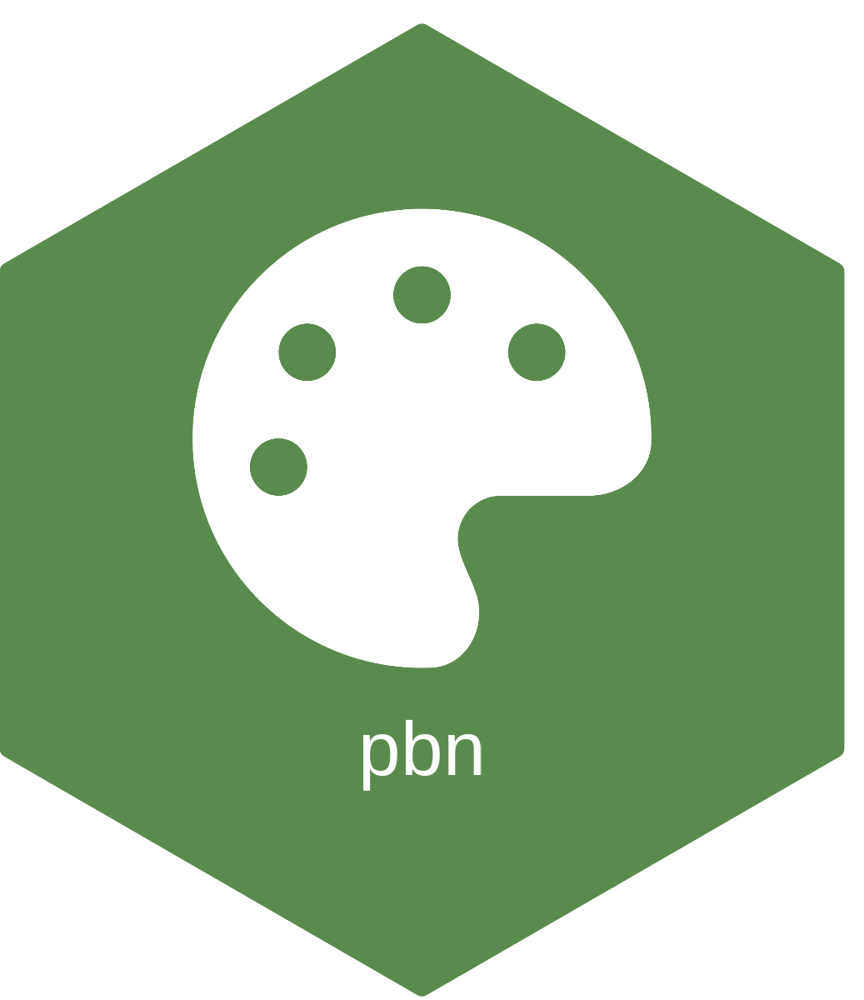

# pbn <a href="https://www.rwhite.no/pbn/"></a>

pbn ("paint by numbers") holds the house layout of an analysis project, the
checks of that layout, and a few shared helpers. It is the one policy package
of the family. `org` (paths), `cohort` (exclusions) and `plnr` (plans) are
mechanism packages without opinions.

This is a trial version. It holds the smallest set of functions that one real
project can use.

## Installation

```r
pak::pak("raubreywhite/pbn")
```

## Quick start

A project version has a run script `v01_run.R` and a folder
`v01_functions/`. `v01_functions/_cfg.R` names the scenarios: the real data,
and fake data that the project writes itself. The same run script runs on
each scenario. From the project folder, run every scenario and check the
layout:

```r
pbn::run_scenarios("v01")
pbn::check_project()
```

`run_scenarios()` writes the run artefacts `run.log` and `run.ok` into each results folder. List both in the `.gitignore` of the project.

## The results

`save_results()` saves each result under the name that the run script gives it, for example `estimates = e` or `p_interaction = p`. pbn adds the element `manifest`. A result is a data.frame, an atomic vector, `NULL`, or a list of these to any depth. A fitted model is an error. Pass the analysis data as `d = d`, so pbn can refuse a result with one value for each row of the data. Pass `d = NULL` when the run has no single data table.

The article
[Get started](https://www.rwhite.no/pbn/articles/pbn.html) builds a small
fake project file by file, and runs it. Read it first.

## The nine functions

| Function | What it does |
|---|---|
| `initialize_project()` | Starts one simulation of one scenario with the house defaults of `org`, and sources `vNN_functions/`. |
| `use_scenario()` | Chooses the scenario of the next `initialize_project()` when a person steps through a run script by hand. |
| `end_if_fake_scenario()` | Ends a run script after `save_results()` when the scenario is fake. |
| `run_scenarios()` | Runs `vNN_run.R` for each scenario and simulation in a new R session, `workers` of them at the same time. It stacks the simulations and checks the assertions. With `resume = TRUE`, it keeps each simulation with results from the same code. |
| `save_results()` | Writes `results.qs2` with a manifest, and stops when the object fails the contract. |
| `read_results()` | Reads the `results.qs2` of one scenario. The default is `"real"`. |
| `check_results()` | Checks a results object against the contract. |
| `check_project()` | Checks a project folder against the house layout, and quits with status 1 on a failure when R is not interactive. |
| `table1()` | Computes the numbers of a descriptive table, with chi-square or Fisher's exact p-values. |

The help page of each function holds its rules. The
[reference](https://www.rwhite.no/pbn/reference/index.html) lists them.
