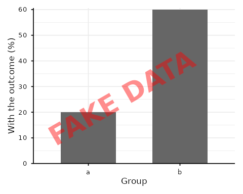

# Get started with pbn

This article is the manual of pbn. It builds one small fake project file
by file, and runs it.

## What pbn is for

Most analysis projects have a layout of their own. A number in a
manuscript then often has no clear path back to the code and the data
that made it. Tests on fake data, where they exist, run apart from the
analysis. pbn gives each project one layout and one run script. The run
script is a `plnr` plan, and the real data is one scenario among fake
ones.

## The layout

Names are lower case, with a few exceptions such as `README.md` and the
initials in a manuscript file name.
[`?check_project`](https://www.rwhite.no/pbn/reference/check_project.md)
lists every exception. Each version of the analysis has a prefix, here
`v01_`. A project holds these items at the top level:

``` text
v01_run.R                 the run script of version v01
v01_functions/            the config and the functions that the run script sources
v01_results/<scenario>/   the results and the output of each scenario
v01_results/run.md        the log of the last run
v01_cache_gitexclude/     the cache of the data, which git ignores
v01_test/                 optional testthat files for the functions
v01_check_functions.R     optional checks of the functions
v01_frozen.md5            optional md5 of the files of a frozen version
check_project.R           one line: pbn::check_project()
pbn.yml                   the rules of check_project()
manuscript/manual/        manuscripts that a person edits
manuscript/built/vNN/     manuscripts that code builds from the results
background/               documents from outside the project, with names that pbn does not check
adhoc/                    work outside the run script
data_describe/            descriptions of the data
README.md                 what the project is and how to run it
CHANGELOG.md              the changes of each version
AGENTS.md                 the rules for agents that work in the project
.gitignore                the files that git leaves out
```

The rest of this article builds a small fake project in a temporary
folder, file by file, and runs it. The project compares a 0/1 outcome
between two groups, `a` and `b`, adjusted for a covariate `x`.

``` r
root <- file.path(tempdir(), "pbn_get_started")
home <- file.path(root, "project")
dir.create(file.path(home, "v01_functions"), recursive = TRUE)
```

Each project MUST have the file `pbn.yml`. It names the set of house
rules that
[`check_project()`](https://www.rwhite.no/pbn/reference/check_project.md)
and
[`initialize_project()`](https://www.rwhite.no/pbn/reference/initialize_project.md)
use. This project uses the set as it is:

``` yaml
extends: house_2026_11_19
```

The real data of this fake project is a small csv file in the folder
`data`, next to the project folder. In a real project, this folder holds
the real data, and it is outside the repository. The file has 400 rows,
and the column names of a typical export.

``` r
data_dir <- file.path(root, "data")
dir.create(data_dir)
set.seed(4)
d <- data.frame(id = 1:400, group = rep(c("a", "b"), 200), x = round(rnorm(400, 50, 10)))
d$outcome <- rbinom(400, 1, ifelse(d$group == "b", 0.4, 0.25))
d$outcome[sample(400, 12)] <- NA
d$x[sample(400, 20)] <- NA
names(d) <- c("Person ID", "Group", "X", "Outcome")
data.table::fwrite(d, file.path(data_dir, "d.csv"))
```

## The run script

`v01_run.R` runs every scenario as one `plnr` plan. This is the whole
script, and the sections below write each file that it sources:

``` r
pbn::initialize_project(
  version = "v01",
  home = ".",
  folders = c(main = "../data"),
  one_file_home = "N:/durable/project",
  one_file_folders = c(main = "N:/durable/data")
)
# pbn::to_one_file()
scenarios <- pbn::scenarios(CFG)

p <- plnr::Plan$new()
pbn::add_data(p, "d",
  raw = data_raw,
  clean = data_clean,
  cohort = data_cohort,
  after_cohort = data_impute,
  cache = TRUE
)
pbn::add_analyses(p, scenarios, name = "table1", fn = make_table1)
pbn::add_analyses(p, scenarios, name = "models", fn = fit_models, adjust = "x")
pbn::add_analyses(p, scenarios, name = "crude", fn = fit_models, adjust = "none", control = TRUE)
pbn::add_analyses(p, scenarios, name = "predicted", fn = predict_risk)
r <- pbn::run_plan(p, workers = 2)
pbn::save_results(r, p, scenarios, gitexclude = "predicted")

pbn::make_outputs(make_output, scenarios)
# pbn::check_one_file()
```

1.  [`pbn::initialize_project()`](https://www.rwhite.no/pbn/reference/initialize_project.md)
    sources `v01_functions/`, and declares the folder `main` of the real
    data. It also declares the paths on a server without a network, see
    “Running on an air-gapped server”.
2.  [`pbn::scenarios()`](https://www.rwhite.no/pbn/reference/scenarios.md)
    checks `CFG$scenarios` and chooses the scenarios of the run.
3.  [`pbn::add_data()`](https://www.rwhite.no/pbn/reference/add_data.md)
    adds the four steps of the data, and
    [`pbn::add_analyses()`](https://www.rwhite.no/pbn/reference/add_analyses.md)
    adds each analysis kind.
4.  [`pbn::run_plan()`](https://www.rwhite.no/pbn/reference/run_plan.md)
    runs the plan on 2 workers.
5.  [`pbn::save_results()`](https://www.rwhite.no/pbn/reference/save_results.md)
    saves the results, and checks each fake scenario.
6.  [`pbn::make_outputs()`](https://www.rwhite.no/pbn/reference/make_outputs.md)
    writes the figures and the tables.

To look at the data at the console, run the script up to
[`pbn::add_data()`](https://www.rwhite.no/pbn/reference/add_data.md).
Then get the data of one scenario and simulation, here simulation 1 of
`real`:

``` r
d <- pbn::get_data(p, "real")$d
```

The path of `main` is relative to the project folder, because the script
runs there. In a real project, run it with `Rscript v01_run.R` from the
project folder.

Three items have `gitexclude` in their names: the cache, a results file
with data for each person, and the results of each simulation. In a git
repository,
[`run_plan()`](https://www.rwhite.no/pbn/reference/run_plan.md) and
[`save_results()`](https://www.rwhite.no/pbn/reference/save_results.md)
stop until git ignores them. So `.gitignore` MUST hold this line:

``` text
*gitexclude*
```

## The config and the scenarios

`v01_functions/_cfg.R` holds the config of version v01. `CFG$scenarios`
names each scenario and its number of simulations. The scenario `real`
MUST be there, and it uses the real data. Each other scenario is fake:

- `known` has 22 rows, with an odds ratio that a person computed by
  hand.
- `null` has 140 simulations where the outcome does not depend on the
  group.
- `confounded` has 140 simulations where `x` raises the chance of group
  `b` and of the outcome.

The column `output` chooses the fake scenarios that get the figures of
[`make_outputs()`](https://www.rwhite.no/pbn/reference/make_outputs.md).
Each other column of `CFG$scenarios` is a setting of the scenario, and
[`?scenarios`](https://www.rwhite.no/pbn/reference/scenarios.md) gives
the rules. `CFG$data` holds the config that the data code reads, and
`CFG$level` is the level of the confidence intervals.

``` r
CFG <- list(
  scenarios = data.frame(
    scenario = c("real", "known", "null", "confounded"),
    sims = c(1, 1, 140, 140),
    output = c(FALSE, TRUE, FALSE, FALSE)
  ),
  data = list(n_imp = 3),
  level = 0.9,
  vars = data.table::data.table(
    var = c("outcome", "x"),
    type = c("bin", "cont")
  )
)
```

The project reports 90% intervals. A check of the coverage of a 95%
interval needs 288 simulations, and this article must build in a short
time. The section The checks gives the rule.

## The data steps

The data has four steps, and each step has its own file in
`v01_functions/`.
[`pbn::add_data()`](https://www.rwhite.no/pbn/reference/add_data.md)
gets each step as an argument, and runs the steps in this order:

1.  `raw`: `data_raw(scenario, sim)` reads the real file, or makes fake
    data with the same columns.
2.  `clean`: `data_clean(d)` gives the columns clean names.
3.  `cohort`: `data_cohort(d)` applies the exclusions with `cohort`, and
    returns the cohort.
4.  `after_cohort`: `data_impute(cp)` imputes the missing values of `x`.
    The section Imputation is data explains it.

pbn takes the steps apart to count the rows between them. Each exclusion
MUST go through `$exclude_and_track()` in `data_cohort()`, so that the
exclusion table counts it. So `data_clean()` MUST return as many rows as
`data_raw()` gave it, and the cohort MUST start with all of them.
Otherwise the data fails, and the error gives both numbers of rows. The
section A cleaning step that drops a row shows the error.

`data_raw()` reads the real file `d.csv` of the folder `main`, with
`pbn::folder("main", "d.csv")`. Project code reaches a folder outside
the project only through
[`pbn::folder()`](https://www.rwhite.no/pbn/reference/folder.md). A
project MAY declare more folders, for example
`folders = c(main = "../data", lookup = "../codes")`. pbn records the
name, the size and the modification time of each file under each folder.
It never reads the content of a data file, so a data file of 60 GB costs
no time. A file that changed in place, and kept its size and its
modification time, is not seen. pbn sets the seed to `sim` once, before
`data_raw()`, so each simulation has its own data, and a second run
gives the same data.

``` r
# known: group a has 11 rows, 2 with the outcome, 8 without, 1 missing.
# Group b has 11 rows, 6 with the outcome, 4 without, 1 missing.
# Odds ratio of b against a: (6 / 4) / (2 / 8) = 6.
# null: the outcome does not depend on the group or on x.
# confounded: x raises the chance of group b and of the outcome. The log odds
# ratio of b against a, adjusted for x, is 0.5.
data_raw <- function(scenario, sim) {
  if (scenario == "real") {
    return(data.table::fread(pbn::folder("main", "d.csv")))
  }
  if (scenario == "known") {
    return(data.table::data.table(
      `Person ID` = 1:22,
      Group = rep(c("a", "b"), each = 11),
      X = rep(c(31, 45, 38, 52, 40, 33, 47, 36, 50, 42, 44), 2),
      Outcome = c(rep(c(1, 0, NA), c(2, 8, 1)), rep(c(1, 0, NA), c(6, 4, 1)))
    ))
  }
  conf <- scenario == "confounded"
  x <- stats::rnorm(400, 50, 10)
  b <- stats::rbinom(400, 1, stats::plogis(conf * (x - 50) / 5))
  y <- stats::rbinom(400, 1, stats::plogis(-1 + conf * (0.5 * b + (x - 50) / 10)))
  data.table::data.table(
    `Person ID` = 1:400,
    Group = c("a", "b")[b + 1],
    X = replace(round(x), sample(400, 20), NA),
    Outcome = y
  )
}
```

The comment holds the arithmetic of `known` and the truth of
`confounded`, so a reader can check each expected value without R.

``` r
data_clean <- function(d) {
  data.table::setnames(d, janitor::make_clean_names(names(d)))
  d[, outcome := as.integer(outcome)]
  d
}
```

``` r
data_cohort <- function(d) {
  cp <- cohort::CohortPipeline$new(d)
  cp$exclude_and_track("root", "missing outcome", "is.na(outcome)")
  cp
}
```

``` r
data_impute <- function(cp) {
  d <- pbn::cohort_data(cp)
  fit <- stats::lm(x ~ group + outcome, data = d)
  miss <- which(is.na(d$x))
  mu <- stats::predict(fit, d[miss])
  for (k in seq_len(CFG$data$n_imp)) {
    col <- paste0("x_", k)
    d[, (col) := x]
    data.table::set(d, miss, col, round(mu + stats::rnorm(length(miss), 0, stats::sigma(fit))))
  }
  d
}
```

The value of `data_cohort()` is a
[`cohort::CohortPipeline`](https://www.rwhite.no/cohort/reference/CohortPipeline.html).
`pbn::cohort_data(cp)` gives its data.table after the exclusions to the
next step. pbn puts the exclusion table of the cohort on the value of
`data_impute()`, so
[`save_results()`](https://www.rwhite.no/pbn/reference/save_results.md)
still stores that table.
[`?add_data`](https://www.rwhite.no/pbn/reference/add_data.md) and
[`?cohort_data`](https://www.rwhite.no/pbn/reference/cohort_data.md)
give the rules.

Data that does not fit the four steps, for example data that joins two
cohorts, goes to
[`add_data()`](https://www.rwhite.no/pbn/reference/add_data.md) as one
function: `fn = function(scenario, sim)`. pbn then checks no rows inside
it, and a step after the cohort in `fn` returns its value through
`pbn::keep_exclusions(x, cp)`.

## The analyses and the controls

An action function takes `data` and `argset`, as in any `plnr` plan.
`data$d` is the data of the scenario and simulation. `argset` holds
`scenario`, `sim`, the extra dimensions and the settings.

``` r
make_table1 <- function(data, argset) {
  pbn::table1(data$d, by = "group", vars = CFG$vars)
}

# The predicted risk of each person, from the model of the first imputation.
predict_risk <- function(data, argset) {
  fit <- stats::glm(outcome ~ group + x_1, family = "binomial", data = data$d)
  data.frame(person_id = data$d$person_id, risk = stats::fitted(fit))
}
```

`fit_models()` fits the model once for each imputation, and pools the
log odds ratio of group `b` with Rubin’s rules. The extra dimension
`adjust` chooses the model: `"x"` adjusts for `x`, and `"none"` is the
crude model.

``` r
fit_models <- function(data, argset) {
  if (plnr::is_run_directly()) {
    argset <- pbn::get_argset(p, "confounded", 3, "models")
    data <- pbn::get_data(p, "confounded", 3)
  }
  est <- numeric(0)
  w <- numeric(0)
  for (k in seq_len(CFG$data$n_imp)) {
    rhs <- if (argset$adjust == "none") "group" else paste0("group + x_", k)
    fit <- stats::glm(stats::as.formula(paste("outcome ~", rhs)), family = "binomial", data = data$d)
    est[k] <- stats::coef(fit)[["groupb"]]
    w[k] <- stats::vcov(fit)["groupb", "groupb"]
    pbn::progress(k, CFG$data$n_imp, "imputations")
  }
  # Rubin's rules: the variance within the imputations, plus (1 + 1/m) times
  # the variance between them.
  se <- sqrt(mean(w) + (1 + 1 / length(est)) * stats::var(est))
  z <- stats::qnorm(1 - (1 - CFG$level) / 2)
  data.frame(term = "group b", estimate = mean(est), se = se, lower = mean(est) - z * se, upper = mean(est) + z * se)
}
```

The kind `crude` has `control = TRUE`, so it runs for the fake scenarios
only and never appears in the real results. It is a control: in
`confounded` it MUST be wrong. A crude model without bias shows that the
confounder of the scenario is too weak for a check of the adjusted
model.

## The checks and the output function

Each fake scenario needs a function `expect_<scenario>(results)`. It
gets the results of the scenario, with one element for each analysis
kind, and returns the assertions on them. `expect_real()` is optional.
The section The checks explains these three:

``` r
expect_known <- function(results) {
  t1 <- results$table1
  observed <- c(
    t1$events[t1$var == "outcome" & t1$grp == "b"],
    exp(results$crude$estimate)
  )
  expected <- c(6, 6)
  data.frame(
    assertion = c("outcome events in group b", "crude odds ratio of b against a"),
    expected = expected,
    observed = observed,
    pass = abs(observed - expected) < 1e-6
  )
}

expect_null <- function(results) {
  pbn::expect_recovers(results$models, truth = 0, level = CFG$level, label = "adjusted model")
}

expect_confounded <- function(results) {
  rbind(
    pbn::expect_recovers(results$models, truth = 0.5, level = CFG$level, label = "adjusted model"),
    pbn::expect_biased(results$crude, truth = 0.5, label = "crude model")
  )
}
```

The output function `make_output(results, dir)` writes the figures and
the tables of one scenario into the folder `dir`. The section The output
explains it.

``` r
make_output <- function(results, dir) {
  pd <- results$table1[var == "outcome" & grp != "All"]
  q <- ggplot2::ggplot(pd, ggplot2::aes(x = grp, y = pct))
  q <- q + ggplot2::geom_col(width = 0.6, fill = "grey40")
  q <- q + ggplot2::expand_limits(y = 0)
  q <- q + ggplot2::scale_y_continuous(expand = ggplot2::expansion(mult = c(0, 0.01)))
  q <- q + ggplot2::labs(x = "Group", y = "With the outcome (%)")
  q <- q + ggplot2::theme_minimal(base_size = 13)
  q <- q + ggplot2::theme(
    axis.line = ggplot2::element_line(colour = "black", linewidth = 0.6),
    axis.ticks = ggplot2::element_line(colour = "black", linewidth = 0.6),
    axis.text = ggplot2::element_text(colour = "black"),
    axis.title = ggplot2::element_text(colour = "black")
  )
  q <- pbn::stamp_fake(q)
  ggplot2::ggsave(file.path(dir, "outcome_by_group.png"), q, width = 5, height = 4, dpi = 96)
}
```

## Running the plan

Here [`source()`](https://rdrr.io/r/base/source.html) with
`chdir = TRUE` runs the script, so the plan stays in this R session.
[`run_plan()`](https://www.rwhite.no/pbn/reference/run_plan.md) prints
one line for each scenario and simulation, and
[`save_results()`](https://www.rwhite.no/pbn/reference/save_results.md)
prints the assertions. This chunk counts the lines of the data:

``` r
out <- utils::capture.output(source(file.path(home, "v01_run.R"), chdir = TRUE))
#> Sourcing all code inside /tmp/RtmpvhOFNd/pbn_get_started/project/v01_functions into R_GlobalEnv
data_lines <- grep("^pbn: data", out, value = TRUE)
table(sub("^pbn: data d, [a-z]+ sim_[0-9]{4}: ", "", data_lines))
#> 
#> computed, because there is no cache file. 
#>                                       282
```

plnr ran the data steps once for each of the 282 scenarios and
simulations, and gave the data to every analysis of that simulation.
[`add_analyses()`](https://www.rwhite.no/pbn/reference/add_analyses.md)
adds one analysis for each scenario, simulation and value of the extra
dimensions. pbn adds the analyses `<scenario>__sim_<kkkk>__pbn_n_rows`,
which count the rows of the data for the manifest.

``` r
length(p$analyses)
#> [1] 1409
head(names(p$analyses), 5)
#> [1] "real__sim_0001__pbn_n_rows"  "known__sim_0001__pbn_n_rows"
#> [3] "null__sim_0001__pbn_n_rows"  "null__sim_0002__pbn_n_rows" 
#> [5] "null__sim_0003__pbn_n_rows"
```

`workers = 2` runs the analyses on 2 new R sessions, in a PSOCK cluster,
through the packages future and doFuture. pbn gives each worker the
objects that `v01_functions/` defines and the attached packages, so the
functions find `CFG` and each other. The data and each analysis set
their own seed. So one analysis by hand in this R session gives the
value of the worker:

``` r
by_hand <- p$run_one("confounded__sim_0003__models__1")
#> pbn: data d, confounded sim_0003: reused the cache of 2026-11-19 13:27.
identical(by_hand, r[["confounded__sim_0003__models__1"]])
#> [1] TRUE
```

This holds for functions that depend only on their arguments, the
functions and `CFG` of `v01_functions/`, the attached packages and the
seed. pbn does not copy the R options to the workers.

Each worker runs with 1 thread. Without this, packages such as
data.table, fixest and a threaded BLAS start many threads in each
worker. The computer then runs far more threads than it has cores.
[`run_plan()`](https://www.rwhite.no/pbn/reference/run_plan.md) starts
each worker with `OMP_NUM_THREADS`, `OPENBLAS_NUM_THREADS` and
`MKL_NUM_THREADS` at 1, and calls `data.table::setDTthreads(1)` there.
An analysis that needs more threads sets them in its own code, for
example `data.table::setDTthreads(4)` at the top of its function. With
`workers = 1`, pbn changes no thread setting.
[`?run_plan`](https://www.rwhite.no/pbn/reference/run_plan.md) gives the
caveat of a threaded BLAS.

An analysis MUST NOT change `CFG` or another object of `v01_functions/`.
A later analysis in the same R session would see the change, so its
result would depend on the analyses before it.
[`run_plan()`](https://www.rwhite.no/pbn/reference/run_plan.md) fails
such an analysis, also for the index that a data.table subset such as
`CFG$vars[var == "x"]` adds in place.
[`?add_analyses`](https://www.rwhite.no/pbn/reference/add_analyses.md)
gives the rules.

## Progress

[`run_plan()`](https://www.rwhite.no/pbn/reference/run_plan.md) shows
one line for each scenario: its finished analyses, the time since its
start, and a note. In an interactive terminal, it draws the lines again
in place, for example:

``` text
pbn: 4 scenarios, 2 workers, started 14:02, 1m 11s
  real          3/3   analyses       5s  done
  known         4/4   analyses       1s  done
  null        168/560 analyses   1m 05s  models (x, sim 43) imputations 2/3 66%
  confounded    0/560 analyses           waiting
```

The header gives the time since the start of the run. In RStudio, it
draws one line again in place. A run with `Rscript` into a log adds
lines instead, and each line starts with the time since the start of the
run:

``` text
pbn: [12m 05s] null 522/1200 analyses, 8m 53s, about 12m left
```

It adds none in the first 60 seconds of the run, so a short run adds
none. After that, it adds one line when a scenario finishes. A running
scenario gets at most one line every 60 seconds, and only with 10% more
done. The section Progress of
[`?run_plan`](https://www.rwhite.no/pbn/reference/run_plan.md) gives the
rules.

A line counts the failed analyses too, for example
`null 37/1200 analyses, 12 failed`. The time left comes from the
analyses without a failure. The first failed analysis stops the run,
because pbn saves nothing from a run with a failure. The display says so
at once, also in the first 60 seconds of a log:

``` text
pbn: [3s] an analysis of the scenario real failed, so the run stops early: no new analysis starts.
```

`fit_models()` calls
[`pbn::progress()`](https://www.rwhite.no/pbn/reference/progress.md) in
its loop over the imputations. While the analysis runs, the line of its
scenario shows its text, as for `null` above. The text holds the kind,
the values of the extra dimensions, the simulation, the step and the
percent. Outside
[`run_plan()`](https://www.rwhite.no/pbn/reference/run_plan.md),
[`pbn::progress()`](https://www.rwhite.no/pbn/reference/progress.md)
only checks its arguments, so the function also runs by hand.

[`pbn::progress()`](https://www.rwhite.no/pbn/reference/progress.md)
does nothing in a forked child process, for example inside
[`parallel::mclapply()`](https://rdrr.io/r/parallel/mclapply.html). Call
it in the loop of the analysis, between chunks of the work:

``` r
for (chunk in split(seq_len(2000), ceiling(seq_len(2000) / 100))) {
  est <- c(est, unlist(parallel::mclapply(chunk, one_replicate, mc.cores = 4)))
  pbn::progress(length(est), 2000, "bootstrap")
}
```

## The results

[`save_results()`](https://www.rwhite.no/pbn/reference/save_results.md)
wrote one results object for each scenario and simulation. git gets one
`results.qs2` for each scenario, and `check.csv`, the table of the
assertions of a fake scenario. For more than 1 simulation, `results.qs2`
holds the simulations stacked. The results of each simulation are in
`sims_gitexclude/`, which git ignores. Here `sim_<kkkk>` stands for the
140 simulations:

``` r
files <- list.files(file.path(home, "v01_results"), recursive = TRUE)
unique(sub("sim_[0-9]{4}", "sim_<kkkk>", files))
#>  [1] "confounded/check.csv"                                 
#>  [2] "confounded/results_gitexclude.qs2"                    
#>  [3] "confounded/results.qs2"                               
#>  [4] "confounded/sims_gitexclude/sim_<kkkk>_gitexclude.qs2" 
#>  [5] "confounded/sims_gitexclude/sim_<kkkk>.qs2"            
#>  [6] "known/check.csv"                                      
#>  [7] "known/output_fake_data/fake_data_outcome_by_group.png"
#>  [8] "known/results_gitexclude.qs2"                         
#>  [9] "known/results.qs2"                                    
#> [10] "null/check.csv"                                       
#> [11] "null/results_gitexclude.qs2"                          
#> [12] "null/results.qs2"                                     
#> [13] "null/sims_gitexclude/sim_<kkkk>_gitexclude.qs2"       
#> [14] "null/sims_gitexclude/sim_<kkkk>.qs2"                  
#> [15] "real/output/outcome_by_group.png"                     
#> [16] "real/results_gitexclude.qs2"                          
#> [17] "real/results.qs2"                                     
#> [18] "run.md"
```

A results object is a named list. The first element is `manifest`, and
the second is `exclusions`, the exclusion table of the cohort. Then
comes one element for each analysis kind. The data.frames of one kind
are row-bound, with the extra dimension `adjust` as the first column.
[`?save_results`](https://www.rwhite.no/pbn/reference/save_results.md)
gives the rules.

``` r
res <- pbn::read_results("v01", home = home)
names(res)
#> [1] "manifest"   "exclusions" "table1"     "models"     "predicted"
res$exclusions
#>   data            step n_before n_excluded n_after
#> 1    d missing outcome      400         12     388
res$models
#>   adjust    term estimate        se     lower     upper
#> 1      x group b 0.560694 0.2267864 0.1876635 0.9337245
```

[`read_results()`](https://www.rwhite.no/pbn/reference/read_results.md)
reads the real results by default. With `scenario`, it reads the results
of a fake scenario, and with `sim` one simulation from
`sims_gitexclude/`. A clone of the repository has no such file, so
[`read_results()`](https://www.rwhite.no/pbn/reference/read_results.md)
with `sim` then stops and says how to make the file. The stacked results
of `confounded` have a first column `sim`:

``` r
confounded <- pbn::read_results("v01", scenario = "confounded", home = home)
head(confounded$models, 3)
#>   sim adjust    term  estimate        se      lower     upper
#> 1   1      x group b 0.6138863 0.2640282  0.1795986 1.0481741
#> 2   2      x group b 0.1540285 0.2794747 -0.3056665 0.6137234
#> 3   3      x group b 0.6156965 0.2775615  0.1591484 1.0722446
```

The manifest records where the results come from. It holds the versions
of R, pbn and the packages of this R session and of the workers, the
date, the scenario and the simulation. `source_md5` holds the md5 of
`v01_run.R` and of each file in `v01_functions/` but `blocks.R`. The md5
of `v01_run.R` leaves out the paths of the server and the two commented
lines. So a run script that gains them keeps its results current.
[`?initialize_project`](https://www.rwhite.no/pbn/reference/initialize_project.md)
gives the rule. For the real data, `data_files` holds the name, the size
and the modification time of each data file. The name is
`<folder>/<path in the folder>`, for example `main/d.csv`. It never
holds the path of a folder. So the same files in another place give the
same results, when the copy keeps the modification times. A copy with
new times looks like changed data, and the cache computes the data
again. For a fake scenario, `fake_md5` holds the md5 of the code of the
data steps. `n_rows_data` holds the number of rows of the data after the
exclusions.

``` r
str(res$manifest[c("scenario", "sim", "sims", "data_files", "n_rows_data", "n_rows_before_exclusions", "analyses")])
#> List of 7
#>  $ scenario                : chr "real"
#>  $ sim                     : int 1
#>  $ sims                    : int 1
#>  $ data_files              :'data.frame':    1 obs. of  3 variables:
#>   ..$ file : chr "main/d.csv"
#>   ..$ size : num 4266
#>   ..$ mtime: num 1.8e+09
#>  $ n_rows_data             : Named int 388
#>   ..- attr(*, "names")= chr "d"
#>  $ n_rows_before_exclusions: Named int 400
#>   ..- attr(*, "names")= chr "d"
#>  $ analyses                :'data.frame':    3 obs. of  3 variables:
#>   ..$ analysis: chr [1:3] "table1" "models" "predicted"
#>   ..$ control : logi [1:3] FALSE FALSE FALSE
#>   ..$ file    : chr [1:3] "results.qs2" "results.qs2" "results_gitexclude.qs2"
```

[`save_results()`](https://www.rwhite.no/pbn/reference/save_results.md)
checks each results object with
[`check_results()`](https://www.rwhite.no/pbn/reference/check_results.md)
before it writes anything. It stops on a fitted model or a function in
the results. It also stops on a table with one row for each row of the
data, before or after the exclusions. That check compares sizes only, so
check the small groups by hand.

### Results with data for each person

A results file goes to git, so it MUST NOT hold one row for each person.
Some results do: fitted models, the imputations, or the predicted risk
of `predict_risk()`. `save_results(gitexclude = "predicted")` writes
that kind to `results_gitexclude.qs2`, beside `results.qs2`, and to
`sim_<kkkk>_gitexclude.qs2` for each simulation. The line `*gitexclude*`
of `.gitignore` keeps that file out of git.
[`read_results()`](https://www.rwhite.no/pbn/reference/read_results.md)
reads both files and returns one list:

``` r
list.files(file.path(home, "v01_results", "real"))
#> [1] "output"                 "results_gitexclude.qs2" "results.qs2"
nrow(res$predicted)
#> [1] 388
```

A coauthor who clones the repository has no `results_gitexclude.qs2`.
[`read_results()`](https://www.rwhite.no/pbn/reference/read_results.md)
then returns the other elements, with one warning:

``` r
private <- file.path(home, "v01_results", "real", "results_gitexclude.qs2")
file.rename(private, file.path(root, "kept.qs2"))
#> [1] TRUE
names(pbn::read_results("v01", home = home))
#> Warning: The manifest names the analysis kinds predicted in
#> /tmp/RtmpvhOFNd/pbn_get_started/project/v01_results/real/results_gitexclude.qs2,
#> and that file is missing, for example in a clone of the repository.
#> read_results() returns the other elements.
#> [1] "manifest"   "exclusions" "table1"     "models"
file.rename(file.path(root, "kept.qs2"), private)
#> [1] TRUE
```

[`check_results()`](https://www.rwhite.no/pbn/reference/check_results.md)
and
[`check_project()`](https://www.rwhite.no/pbn/reference/check_project.md)
do not check what the kinds in `gitexclude` hold, so `predicted` passes
the check of the rows of the data. The
[`check_project()`](https://www.rwhite.no/pbn/reference/check_project.md)
rule `gitexclude_not_tracked` fails when git tracks a path with
`gitexclude` in its name.

## The run log

[`save_results()`](https://www.rwhite.no/pbn/reference/save_results.md)
writes the log of the run to `v01_results/run.md`, and
[`make_outputs()`](https://www.rwhite.no/pbn/reference/make_outputs.md)
adds its files to it. Each run replaces the file. The log holds these
items:

- the result of the run, and the failures first
- the scenarios, the cache and the rows of the data, and the exclusion
  tables
- the assertions, the output files and the results files
- the timings
- the history, one line for each run of this version

It holds counts and assertions only, as `check.csv` does. It never holds
the text of an error, because an error message can hold a value of the
data. It gives each error a number, and
`v01_results/run_errors_gitexclude.md` holds the text, out of git.
[`?save_results`](https://www.rwhite.no/pbn/reference/save_results.md)
lists the errors. These are the first sections of the log of the run
above:

``` r
log <- readLines(file.path(home, "v01_results", "run.md"))
cat(log[seq_len(grep("^## Exclusions", log) - 1)], sep = "\n")
```

    #> # Run log of `project`, version v01
    #> 
    #> ## When
    #> 
    #> The run started 2026-11-19 13:27:36 +0000. This section and the sections Timings and History change in every run. The other sections change when the code, the data, the cache, the packages or the files on the disk change.
    #> 
    #> ## Run
    #> 
    #> - Result: All 9 assertions passed.
    #> - Scenarios of this run: real, known, null and confounded.
    #> - R version 4.6.2 (2026-10-29).
    #> - Packages: pbn 2026.11.26, plnr 2026.11.19 and cohort 2026.11.18, and 58 other packages, listed in the manifest of each results file.
    #> - Workers: 2.
    #> 
    #> ## Scenarios
    #> 
    #> | Scenario   | Simulations | Analyses |
    #> |------------|------------:|---------:|
    #> | real       |           1 |        3 |
    #> | known      |           1 |        4 |
    #> | null       |         140 |      560 |
    #> | confounded |         140 |      560 |
    #> 
    #> ## Data
    #> 
    #> | Data    | Scenario   | Simulations | Cache        | Rows before exclusions | Rows after exclusions | Rows of the data |
    #> |---------|------------|------------:|--------------|-----------------------:|----------------------:|-----------------:|
    #> | d       | real       |           1 | computed 1   |                    400 |                   388 |              388 |
    #> | d       | known      |           1 | computed 1   |                     22 |                    20 |               20 |
    #> | d       | null       |         140 | computed 140 |                    400 |                   400 |              400 |
    #> | d       | confounded |         140 | computed 140 |                    400 |                   400 |              400 |
    #> 
    #> The scenario real reads the folder `main` (1 file).
    #> 
    #> The cache line of simulation 1 of each scenario, as run_plan() printed it:
    #> 
    #> ```
    #> pbn: data d, real sim_0001: computed, because there is no cache file.
    #> pbn: data d, known sim_0001: computed, because there is no cache file.
    #> pbn: data d, null sim_0001: computed, because there is no cache file.
    #> pbn: data d, confounded sim_0001: computed, because there is no cache file.
    #> ```

The log is Markdown, so it reads well as plain text and on GitHub. Put
it in git. Only the sections When, Timings and History change in every
run, so `git diff` on the log shows the real changes of a run. The
sections Timings and History come last.

The timings are seconds on the clock. pbn measures each data step and
each analysis where it runs, also on a worker. A scenario runs from the
start of its first data step or analysis to the end of its last one.
With 2 workers the scenarios overlap, so their seconds do not add up to
those of
[`run_plan()`](https://www.rwhite.no/pbn/reference/run_plan.md). Each
data step and analysis kind gets the median and the maximum seconds of
one call, and its share of all the seconds:

``` r
cat(log[seq(grep("^## Timings", log), grep("^## History", log) - 1)], sep = "\n")
#> ## Timings
#> 
#> The numbers of this section change in every run. Each one is seconds on the clock. pbn measures a data step and an analysis where it runs, also on a worker.
#> 
#> ### Main session
#> 
#> | Step                                               | Wall seconds |
#> |----------------------------------------------------|-------------:|
#> | run_plan()                                         |        12.32 |
#> | save_results(): build, write and stack the results |         2.20 |
#> | save_results(): the checks of check_results()      |         1.24 |
#> | save_results(): the expect_ functions              |         0.13 |
#> | save_results() in total                            |         3.68 |
#> | make_outputs(): real                               |         0.80 |
#> | make_outputs(): known                              |         0.56 |
#> 
#> ### Scenarios
#> 
#> A scenario runs from the start of its first data step or analysis to the end of its last one. With workers, the scenarios overlap, so these seconds do not add up to the seconds of run_plan().
#> 
#> | Scenario   | Wall seconds |
#> |------------|-------------:|
#> | real       |         0.78 |
#> | known      |         0.12 |
#> | null       |         5.37 |
#> | confounded |         5.15 |
#> 
#> ### Data steps
#> 
#> | Data | Scenario   | Step         | Calls | Median | Maximum | Share |
#> |------|------------|--------------|------:|-------:|--------:|------:|
#> | d    | real       | raw          |     1 |   0.02 |    0.02 |  0.2% |
#> | d    | real       | clean        |     1 |   0.49 |    0.49 |  5.0% |
#> | d    | real       | cohort       |     1 |   0.01 |    0.01 |  0.1% |
#> | d    | real       | after_cohort |     1 |   0.02 |    0.02 |  0.2% |
#> | d    | known      | raw          |     1 |   0.00 |    0.00 |  0.0% |
#> | d    | known      | clean        |     1 |   0.01 |    0.01 |  0.1% |
#> | d    | known      | cohort       |     1 |   0.00 |    0.00 |  0.0% |
#> | d    | known      | after_cohort |     1 |   0.00 |    0.00 |  0.0% |
#> | d    | null       | raw          |   140 |   0.00 |    0.02 |  0.7% |
#> | d    | null       | clean        |   140 |   0.01 |    0.20 |   13% |
#> | d    | null       | cohort       |   140 |   0.00 |    0.01 |  1.5% |
#> | d    | null       | after_cohort |   140 |   0.00 |    0.02 |  6.8% |
#> | d    | confounded | raw          |   140 |   0.00 |    0.00 |  0.3% |
#> | d    | confounded | clean        |   140 |   0.01 |    0.01 |   11% |
#> | d    | confounded | cohort       |   140 |   0.00 |    0.00 |  1.2% |
#> | d    | confounded | after_cohort |   140 |   0.00 |    0.02 |  6.5% |
#> 
#> ### Analysis kinds
#> 
#> | Scenario   | Kind      | Analyses | Median | Maximum | Share |
#> |------------|-----------|---------:|-------:|--------:|------:|
#> | real       | table1    |        1 |   0.00 |    0.00 |  0.0% |
#> | real       | models    |        1 |   0.11 |    0.11 |  1.1% |
#> | real       | predicted |        1 |   0.00 |    0.00 |  0.0% |
#> | known      | table1    |        1 |   0.01 |    0.01 |  0.1% |
#> | known      | models    |        1 |   0.01 |    0.01 |  0.1% |
#> | known      | crude     |        1 |   0.01 |    0.01 |  0.1% |
#> | known      | predicted |        1 |   0.00 |    0.00 |  0.0% |
#> | null       | table1    |      140 |   0.00 |    0.01 |  4.0% |
#> | null       | models    |      140 |   0.01 |    0.10 |   11% |
#> | null       | crude     |      140 |   0.01 |    0.01 |  8.9% |
#> | null       | predicted |      140 |   0.00 |    0.01 |  3.0% |
#> | confounded | table1    |      140 |   0.00 |    0.01 |  3.7% |
#> | confounded | models    |      140 |   0.01 |    0.01 |  9.7% |
#> | confounded | crude     |      140 |   0.01 |    0.01 |  8.8% |
#> | confounded | predicted |      140 |   0.00 |    0.00 |  2.7% |
#> 
#> Median and Maximum are the seconds of one call. Share is the part of the seconds of all data steps and analyses of the run.
```

The section History has one line for each run of this version, oldest
first, with its result and the wall seconds of its steps. At its start,
[`run_plan()`](https://www.rwhite.no/pbn/reference/run_plan.md) adds the
line “did not finish”, and the full log replaces it. A run that R stops
thus keeps that line. The history is in `run.md` only, so a deleted
`run.md` starts it again. The section A check that goes red below adds
lines to it.

`pbn::render_run("v01")` renders the log to `v01_results/run.pdf`. It
needs Quarto, and no LaTeX. The PDF is made from `run.md`, so keep it
out of git, for example with the line `run.pdf` in `.gitignore`:

``` r
pdf <- withr::with_dir(home, pbn::render_run("v01"))
file.exists(file.path(home, pdf))
```

## The checks

[`save_results()`](https://www.rwhite.no/pbn/reference/save_results.md)
calls `expect_<scenario>()` on the results of each fake scenario, and
writes the assertions to `check.csv`. It stops when one did not pass.

`expect_known()` tests two outputs against numbers that a person
computed by hand. It does not test how the analysis behaves on data as
large or as untidy as the real data.

`expect_null()` and `expect_confounded()` are recovery checks.
[`pbn::expect_recovers()`](https://www.rwhite.no/pbn/reference/expect_recovers.md)
checks the bias, the standard error and the coverage of the estimate
over the simulations. Each limit comes from the Monte Carlo standard
error of the measure.
[`pbn::expect_biased()`](https://www.rwhite.no/pbn/reference/expect_biased.md)
checks that the control is biased. These are the assertions of
`confounded`:

``` r
knitr::kable(utils::read.csv(file.path(home, "v01_results", "confounded", "check.csv")))
```

| assertion | expected | observed | pass |
|:---|:---|:---|:---|
| adjusted model: bias of estimate against 0.5 | \|bias\| \<= 0.0932 (3.89 MCSE); can detect \|bias\| of 0.113 | 0.031; 140 of 140 simulations | TRUE |
| adjusted model: model SE of estimate against its SD | \|relative error\| \<= 23.6% (3.89 MCSE); can detect ModSE/EmpSE of 0.772 or 1.37 | +1.1% (ModSE 0.286, EmpSE 0.283); 140 of 140 simulations | TRUE |
| adjusted model: coverage of 0.5 by the 90% interval | 0.801 to 0.999 (3.89 MCSE); can detect coverage of 0.771 | 0.914; 140 of 140 simulations | TRUE |
| crude model: bias of estimate against 0.5, a control | \|bias\| \> 0.0715 (3.89 MCSE); can detect \|bias\| of 0.087 | 1.05; 140 of 140 simulations | TRUE |

“can detect” is the smallest error that the check finds with a
probability of 80% at this number of simulations. A row passes when
`observed` is inside the limit in `expected`, and a large “can detect”
means that the row passes almost anything.

Give the checks the estimate on the scale where it is near normal: a log
odds ratio, with a truth on the log scale. Below 100 simulations, or 137
for the coverage at the level 0.9, each assertion fails with “too few
simulations to check”. `expect_recovers(coverage = FALSE)` makes no
coverage assertion, so 100 simulations are enough, and `x` needs no
`lower` and `upper`.
[`?expect_recovers`](https://www.rwhite.no/pbn/reference/expect_recovers.md)
gives the formulas, the rule for missing estimates and the probability
of a false alarm.

The crude model does not recover the truth of `confounded`. These are
the assertions that a wrong analysis gets:

``` r
pbn::expect_recovers(confounded$crude, truth = 0.5, level = CFG$level, label = "crude model")[, c("assertion", "observed", "pass")]
#>                                          assertion
#> 1        crude model: bias of estimate against 0.5
#> 2 crude model: model SE of estimate against its SD
#> 3 crude model: coverage of 0.5 by the 90% interval
#>                                                   observed  pass
#> 1                             1.05; 140 of 140 simulations FALSE
#> 2 +6.0% (ModSE 0.231, EmpSE 0.218); 140 of 140 simulations  TRUE
#> 3                            0.000; 140 of 140 simulations FALSE
```

### A check that goes red

The runs below need the scenarios `real` and `known` only. Change the
line of
[`pbn::scenarios()`](https://www.rwhite.no/pbn/reference/scenarios.md)
in `v01_run.R`, so that each run takes a few seconds:

``` r
run_file <- file.path(home, "v01_run.R")
script <- readLines(run_file)
script <- sub("pbn::scenarios(CFG)", 'pbn::scenarios(CFG, only = c("real", "known"))', script, fixed = TRUE)
writeLines(script, run_file)
grep("pbn::scenarios", script, value = TRUE)
#> [1] "scenarios <- pbn::scenarios(CFG, only = c(\"real\", \"known\"))"
```

`run_lines()` runs the script in a new R session, and shows the lines of
the data:

``` r
run_lines <- function(status = 0) {
  out <- callr::rscript(run_file, wd = home, show = FALSE, fail_on_status = FALSE)
  stopifnot(out$status == status)
  lines <- grep("^pbn: data", strsplit(out$stdout, "\r?\n")[[1]], value = TRUE)
  cat(lines, sep = "\n")
  invisible(lines)
}
```

Make one small error in the analysis: swap the two branches of the `if`
in `fit_models()`. The crude model is then adjusted for `x`, and the
adjusted model is crude. Keep a copy of the file first.

``` r
file <- file.path(home, "v01_functions", "fit_models.R")
file.copy(file, file.path(root, "fit_models_copy.R"))
#> [1] TRUE
code <- readLines(file)
code <- sub('"group" else paste0("group + x_", k)', 'paste0("group + x_", k) else "group"', code, fixed = TRUE)
writeLines(code, file)
grep("rhs <-", readLines(file), value = TRUE)
#> [1] "    rhs <- if (argset$adjust == \"none\") paste0(\"group + x_\", k) else \"group\""
red <- run_lines(status = 1)
#> pbn: data d, real sim_0001: reused the cache of 2026-11-19 13:27.
#> pbn: data d, known sim_0001: reused the cache of 2026-11-19 13:27.
cat(readLines(file.path(home, "v01_results", "known", "check.csv")), sep = "\n")
#> "assertion","expected","observed","pass"
#> "outcome events in group b",6,6,TRUE
#> "crude odds ratio of b against a",6,7.0369269141867,FALSE
```

The real data runs through the same functions as the fake data. A fake
scenario with a known answer thus tests the analysis that gives the real
results. On the real data, the swapped models give plausible odds ratios
and no error. Only the planted odds ratio shows the mistake. The results
files stay, so that you can find the fault, but
[`read_results()`](https://www.rwhite.no/pbn/reference/read_results.md)
stops on them:

``` r
pbn::read_results("v01", scenario = "known", home = home)
#> Error:
#> ! /tmp/RtmpvhOFNd/pbn_get_started/project/v01_results/known/check.csv holds an assertion that did not pass, so read_results() does not read /tmp/RtmpvhOFNd/pbn_get_started/project/v01_results/known/results.qs2. Fix the analysis and run it again. To look at the results for debugging, read them with qs2::qs_read("/tmp/RtmpvhOFNd/pbn_get_started/project/v01_results/known/results.qs2").
```

The same code gave the real results of this run, so
[`read_results()`](https://www.rwhite.no/pbn/reference/read_results.md)
stops on them too.
[`save_results()`](https://www.rwhite.no/pbn/reference/save_results.md)
records each fake scenario with a failed assertion in
`manifest$failed_fake_checks` of the real results:

``` r
pbn::read_results("v01", home = home)
#> Error:
#> ! manifest$failed_fake_checks of /tmp/RtmpvhOFNd/pbn_get_started/project/v01_results/real/results.qs2 names a fake scenario with a failed assertion: "known". Its assertions are in /tmp/RtmpvhOFNd/pbn_get_started/project/v01_results/known/check.csv. Correct the analysis, and run the scenario "real" again with the fake scenarios. To look at the results for debugging, read them with qs2::qs_read("/tmp/RtmpvhOFNd/pbn_get_started/project/v01_results/real/results.qs2").
```

Put the copy back, and run the script again. Its assertions pass.

``` r
file.copy(file.path(root, "fit_models_copy.R"), file, overwrite = TRUE)
#> [1] TRUE
green <- run_lines()
#> pbn: data d, real sim_0001: reused the cache of 2026-11-19 13:27.
#> pbn: data d, known sim_0001: reused the cache of 2026-11-19 13:27.
```

### A cleaning step that drops a row

Make `data_clean()` drop the rows with a missing outcome. That is an
exclusion, and it belongs in `data_cohort()`, where it is already. Keep
a copy of the file first, and show the first failed analysis:

``` r
clean_file <- file.path(home, "v01_functions", "data_clean.R")
file.copy(clean_file, file.path(root, "data_clean_copy.R"))
#> [1] TRUE
code <- sub("^  d$", "  d[!is.na(outcome)]", readLines(clean_file))
writeLines(code, clean_file)
out <- callr::rscript(run_file, wd = home, show = FALSE, fail_on_status = FALSE)
lines <- strsplit(out$stdout, "\r?\n")[[1]]
cat(lines[grep(" failed:$", lines)[1] + 0:1], sep = "\n")
#> pbn: the analysis real__sim_0001__pbn_n_rows failed:
#> The data function 'd' failed: The step clean of the data "d" returned 388 rows, but the step raw returned 400 rows. The step clean MUST return a data.frame with the same number of rows. Put each exclusion in the step cohort, with $exclude_and_track(), so that pbn counts it.
```

Each analysis gets the failed data, so each one fails, and
[`save_results()`](https://www.rwhite.no/pbn/reference/save_results.md)
does not run. In a longer run, the first failed analysis stops the run,
and the analyses after it do not run.
[`?run_plan`](https://www.rwhite.no/pbn/reference/run_plan.md) gives the
rules of the stop. Put the copy back:

``` r
file.copy(file.path(root, "data_clean_copy.R"), clean_file, overwrite = TRUE)
#> [1] TRUE
```

## Imputation is data

A multiple imputation can take hours, and every analysis reads its
result. So it belongs in the data, as the step `after_cohort`. With
`cache = TRUE` in
[`add_data()`](https://www.rwhite.no/pbn/reference/add_data.md),
[`run_plan()`](https://www.rwhite.no/pbn/reference/run_plan.md) saves
the data on disk for each scenario and simulation, in
`v01_cache_gitexclude/`. The next run reads it again while the cache key
is the same. A change of an analysis then runs the analyses only.

`data_impute()` is the step after the cohort, so the imputation model
uses the people of the cohort only. It draws `CFG$data$n_imp` values for
each missing `x`, from a linear model of `x` on `group` and the outcome,
with a normal error. It writes the draws to the columns `x_1`, `x_2` and
`x_3`, and keeps one row for each person. This is stochastic regression
imputation. It does not draw the parameters of the model, so it is not a
proper multiple imputation.

The two runs of the section A check that goes red read the cache. Change
an analysis: `fit_models()` also reports the number of imputations. The
data comes from the cache again:

``` r
code <- readLines(file)
code <- sub("upper = mean(est) + z * se)", "upper = mean(est) + z * se, n_imp = length(est))", code, fixed = TRUE)
writeLines(code, file)
third <- run_lines()
#> pbn: data d, real sim_0001: reused the cache of 2026-11-19 13:27.
#> pbn: data d, known sim_0001: reused the cache of 2026-11-19 13:27.
pbn::read_results("v01", home = home)$models
#>   adjust    term estimate        se     lower     upper n_imp
#> 1      x group b 0.560694 0.2267864 0.1876635 0.9337245     3
```

Change the data code: `data_impute()` keeps one decimal of each draw.
pbn computes the data again, and names the changed file and the changed
step:

``` r
code <- readLines(file.path(home, "v01_functions", "data_impute.R"))
code <- sub("round(mu + ", "round(digits = 1, mu + ", code, fixed = TRUE)
writeLines(code, file.path(home, "v01_functions", "data_impute.R"))
fourth <- run_lines()
#> pbn: data d, real sim_0001: computed, because v01_functions/data_impute.R, the function given as `after_cohort` changed.
#> pbn: data d, known sim_0001: computed, because v01_functions/data_impute.R, the function given as `after_cohort` changed.
```

The section History of the run log now has one line for each run of this
article. The runs with `only = c("real", "known")` name their scenarios:

``` r
log <- readLines(file.path(home, "v01_results", "run.md"))
cat(log[seq(grep("^## History", log) + 4, length(log))], sep = "\n")
#> | Started             | Result                   | Scenarios   |  Workers | run_plan() | save_results() | make_outputs() | pbn        |
#> |---------------------|--------------------------|-------------|---------:|-----------:|---------------:|---------------:|------------|
#> | 2026-11-19 13:27:36 | All 9 assertions passed  | 4           |        2 |      12.32 |           3.68 |           1.36 | 2026.11.26 |
#> | 2026-11-19 13:27:55 | 1 of 2 assertions failed | real, known |        2 |       1.51 |           0.04 |                | 2026.11.26 |
#> | 2026-11-19 13:27:58 | All 2 assertions passed  | real, known |        2 |       1.55 |           0.04 |           1.19 | 2026.11.26 |
#> | 2026-11-19 13:28:01 | 9 of 9 analyses failed   | real, known |        2 |       1.71 |                |                | 2026.11.26 |
#> | 2026-11-19 13:28:04 | All 2 assertions passed  | real, known |        2 |       1.54 |           0.04 |           1.17 | 2026.11.26 |
#> | 2026-11-19 13:28:07 | All 2 assertions passed  | real, known |        2 |       1.79 |           0.04 |           1.21 | 2026.11.26 |
```

The cache key holds the md5 of each `data_*.R` file of `v01_functions/`,
and `CFG$data`. It also holds the code of each step, the fingerprint of
the raw data, the settings, the versions of R and pbn, and
[`RNGkind()`](https://rdrr.io/r/base/Random.html). Beside the key, pbn
records the version of each package loaded when the data was computed. A
new version of one of them computes the data again.
[`?add_data`](https://www.rwhite.no/pbn/reference/add_data.md) gives the
full rule. Keep the data code in `data_*.R` files: a change in another
file does not change the key. To compute every value again, delete
`v01_cache_gitexclude/`.

## Stepping through one analysis by hand

The names of the analyses are `<scenario>__sim_<kkkk>__<name>__<i>`.
`<i>` counts the values of the extra dimensions.
`pbn::get_argset(p, "confounded", 3, "models", 1)` gives the argset of
`confounded__sim_0003__models__1`, and
`pbn::get_data(p, "confounded", 3)` gives its data. The last argument of
[`get_argset()`](https://www.rwhite.no/pbn/reference/get_data.md),
`<i>`, is 1 by default. Put back the line of
[`pbn::scenarios()`](https://www.rwhite.no/pbn/reference/scenarios.md)
in `v01_run.R`, so that the plan has every scenario:

``` r
script <- sub('pbn::scenarios(CFG, only = c("real", "known"))', "pbn::scenarios(CFG)", readLines(run_file), fixed = TRUE)
writeLines(script, run_file)
```

To step through one analysis of `fit_models()` by hand, run the script
up to
[`pbn::run_plan()`](https://www.rwhite.no/pbn/reference/run_plan.md).
Then run the body of the function line by line. At the top level of the
console,
[`plnr::is_run_directly()`](https://www.rwhite.no/plnr/reference/is_run_directly.html)
is `TRUE`, so the first lines load that analysis:

``` r
upto <- script[seq_len(grep("run_plan", script) - 1)]
withr::with_dir(home, eval(parse(text = upto)))
#> Sourcing all code inside /tmp/RtmpvhOFNd/pbn_get_started/project/v01_functions into R_GlobalEnv
argset <- pbn::get_argset(p, "confounded", 3, "models")
data <- pbn::get_data(p, "confounded", 3)
#> pbn: data d, confounded sim_0003: computed, because v01_functions/data_impute.R, the function given as `after_cohort` changed.
argset$adjust
#> [1] "x"
nrow(data$d)
#> [1] 400
```

[`pbn::get_data()`](https://www.rwhite.no/pbn/reference/get_data.md)
uses the cache, as `p$get_data()` does. The data code changed after the
first run, so it computed the data again, and it gave the reason. When
the plan runs `fit_models()`,
[`plnr::is_run_directly()`](https://www.rwhite.no/plnr/reference/is_run_directly.html)
is `FALSE`, and the first lines do nothing. The plan calls
`set.seed(argset$seed)` before each analysis. Run that line too before
you step through a function that draws random numbers.
[`?add_analyses`](https://www.rwhite.no/pbn/reference/add_analyses.md)
says how pbn derives the seed from the kind, its counter and the
simulation.

## The output

`pbn::make_outputs(make_output, scenarios)` calls the output function
for `real` and for each fake scenario with `output = TRUE`. The folder
of `real` is `v01_results/real/output/`. The folder of a fake scenario
is `v01_results/<scenario>/output_fake_data/`, and pbn renames each file
there so that its name starts with `fake_data_`. Before each call, it
empties the folder, so no file of an earlier run stays.

``` r
files <- list.files(file.path(home, "v01_results"), recursive = TRUE)
grep("output", files, value = TRUE)
#> [1] "known/output_fake_data/fake_data_outcome_by_group.png"
#> [2] "real/output/outcome_by_group.png"
```

`q <- pbn::stamp_fake(q)` in `make_output()` puts the label “FAKE DATA”
on the figure of a fake scenario. It returns the figure as it is for
`real`. This is the figure of `known`:



A table or a text file of fake data has the name prefix and the folder
name only, and no label. The
[`check_project()`](https://www.rwhite.no/pbn/reference/check_project.md)
rule `fake_data_names` fails a file in `output_fake_data/` without the
prefix, and a file with the prefix in another folder.

A script with output code after the run that is not in a function MAY
use `pbn::end_unless_real(scenarios)` after
[`save_results()`](https://www.rwhite.no/pbn/reference/save_results.md).
It ends the script when the run had no real data.

## Checking the project

`check_project.R` holds one line.

``` r
pbn::check_project()
```

[`check_project()`](https://www.rwhite.no/pbn/reference/check_project.md)
checks a project folder against the rules of `pbn.yml`. It prints the
name of the set, one line for each rule that passes, one line for each
finding, and a count. Each WARN and FAIL line ends with the fix. The
rule `cyclomatic_complexity` fails a function that scores above 15 in
`cyclocomp`, as the lint gate of the house packages does. The rule
`no_local_assign` fails [`local()`](https://rdrr.io/r/base/eval.html),
[`assign()`](https://rdrr.io/r/base/assign.html), `<<-` and the other
constructs of
[`?check_project`](https://www.rwhite.no/pbn/reference/check_project.md).
Each object then gets its value on the line that names it.

``` r
pbn::check_project(home)
#> Rules: house_2026_11_19, 0 overrides, 0 allowed paths (pbn.yml)
#> PASS  lower_case_names  no capital letter in a name
#> PASS  run_script_initialises  every vNN_run.R calls pbn::initialize_project() with its own version
#> PASS  version_items_complete  every vNN_run.R has a vNN_functions/, and the reverse
#> PASS  frozen_versions_unchanged  every version but the newest has a vNN_frozen.md5, and no file of a frozen version changed after pbn::freeze_version()
#> PASS  results_contract  every vNN_results/<scenario>/results.qs2 and each vNN_results/<scenario>/sims_gitexclude/sim_NNNN.qs2 on the disk passes check_results()
#> PASS  gitexclude_not_tracked  the project is not a git repository, so nothing to check
#> PASS  scenario_checks  every vNN_results/<scenario>/check.csv passes
#> PASS  manual_manuscript_names  every file in manuscript/manual/ is named vNN_<INITIALS>.docx
#> PASS  manuscript_reads_real  manuscript/built/ reads only the real results
#> PASS  fake_data_names  every file in an output_fake_data/ folder, and no file elsewhere, has a name that starts with fake_data_
#> PASS  no_local_copy_of_pbn_function  no vNN_functions/ file defines a pbn export
#> PASS  loc_per_file  no .R file has more than 1000 code lines
#> PASS  cyclomatic_complexity  no function of an .R file has a cyclomatic complexity above 15
#> PASS  no_environment_variables  no Sys.getenv or Sys.setenv in a run script or a functions folder
#> PASS  no_cross_version_reads  no string in a run script or a functions folder names another version or adhoc/
#> PASS  no_local_assign  no .R file calls local, assign, delayedAssign, assignInNamespace or assignInMyNamespace, or uses <<- or ->>
#> PASS  no_escape_hatches  no run script or functions folder calls suppressWarnings(), suppressMessages(), try(), tryCatch() or withCallingHandlers()
#> PASS  no_absolute_paths  no .R file has an absolute path or a file.path() from a string, outside the arguments of pbn::initialize_project()
#> PASS  blocks_list  blocks, when a functions folder has it, is a list of named functions in vNN_functions/blocks.R, and no other code uses a name of that file
#> PASS  real_results_are_fake  no real results on the disk come from fake real data
#> PASS  unknown_path  the house layout names every top-level path
#> 21 PASS, 0 WARN, 0 FAIL, 0 OFF
```

In a non-interactive R session,
[`check_project()`](https://www.rwhite.no/pbn/reference/check_project.md)
quits R with status 1 when a rule fails. Add a file with a capital
letter in its name, and run `check_project.R` in a new R session:

``` r
dir.create(file.path(home, "adhoc"))
writeLines("notes", file.path(home, "adhoc", "Notes.txt"))
out <- callr::rscript(file.path(home, "check_project.R"), wd = home, show = FALSE, fail_on_status = FALSE)
out$status
#> [1] 1
cat(grep("FAIL", strsplit(out$stdout, "\r?\n")[[1]], value = TRUE), sep = "\n")
#> FAIL  lower_case_names  adhoc/Notes.txt: the name has a capital letter. Fix: rename it in lower case.
#> 20 PASS, 0 WARN, 1 FAIL, 0 OFF
unlink(file.path(home, "adhoc"), recursive = TRUE)
```

`pbn.yml` MAY change the set. Under `rules`, it changes the level or a
parameter of a rule. Under `allow`, it lists the paths that a rule
allows. This file raises the limit of `cyclomatic_complexity` to 25,
turns `unknown_path` off, and allows one name with a capital letter:

``` yaml
extends: house_2026_11_19
rules:
  cyclomatic_complexity: {limit: 25}
  unknown_path: off
allow:
  lower_case_names: [adhoc/Notes.txt]
```

``` r
dir.create(file.path(home, "adhoc"))
writeLines("notes", file.path(home, "adhoc", "Notes.txt"))
pbn::check_project(home)
#> Rules: house_2026_11_19, 2 overrides, 1 allowed path (pbn.yml)
#> WARN  lower_case_names  adhoc/Notes.txt: the name has a capital letter (allowed). Fix: rename it in lower case.
#> PASS  run_script_initialises  every vNN_run.R calls pbn::initialize_project() with its own version
#> PASS  version_items_complete  every vNN_run.R has a vNN_functions/, and the reverse
#> PASS  frozen_versions_unchanged  every version but the newest has a vNN_frozen.md5, and no file of a frozen version changed after pbn::freeze_version()
#> PASS  results_contract  every vNN_results/<scenario>/results.qs2 and each vNN_results/<scenario>/sims_gitexclude/sim_NNNN.qs2 on the disk passes check_results()
#> PASS  gitexclude_not_tracked  the project is not a git repository, so nothing to check
#> PASS  scenario_checks  every vNN_results/<scenario>/check.csv passes
#> PASS  manual_manuscript_names  every file in manuscript/manual/ is named vNN_<INITIALS>.docx
#> PASS  manuscript_reads_real  manuscript/built/ reads only the real results
#> PASS  fake_data_names  every file in an output_fake_data/ folder, and no file elsewhere, has a name that starts with fake_data_
#> PASS  no_local_copy_of_pbn_function  no vNN_functions/ file defines a pbn export
#> PASS  loc_per_file  no .R file has more than 1000 code lines
#> PASS  cyclomatic_complexity  no function of an .R file has a cyclomatic complexity above 25
#> PASS  no_environment_variables  no Sys.getenv or Sys.setenv in a run script or a functions folder
#> PASS  no_cross_version_reads  no string in a run script or a functions folder names another version or adhoc/
#> PASS  no_local_assign  no .R file calls local, assign, delayedAssign, assignInNamespace or assignInMyNamespace, or uses <<- or ->>
#> PASS  no_escape_hatches  no run script or functions folder calls suppressWarnings(), suppressMessages(), try(), tryCatch() or withCallingHandlers()
#> PASS  no_absolute_paths  no .R file has an absolute path or a file.path() from a string, outside the arguments of pbn::initialize_project()
#> PASS  blocks_list  blocks, when a functions folder has it, is a list of named functions in vNN_functions/blocks.R, and no other code uses a name of that file
#> PASS  real_results_are_fake  no real results on the disk come from fake real data
#> OFF  unknown_path  off in pbn.yml
#> 19 PASS, 1 WARN, 0 FAIL, 1 OFF
```

The allowed file is now a WARN, and `unknown_path` is OFF. An entry
covers its path and each path under it, with or without a final `/`. So
`lower_case_names: [archive]` allows each finding in `archive/` at any
depth, and no finding in `archive2/`.
[`initialize_project()`](https://www.rwhite.no/pbn/reference/initialize_project.md)
applies `loc_per_file` in the same way to each `.R` file at the top of
`v01_functions/`. It stops on a FAIL, so an allowed long file does not
stop it.
[`?check_project`](https://www.rwhite.no/pbn/reference/check_project.md)
lists the levels, the parameters, and the locked rules that `pbn.yml`
cannot change.

## Verifying a version

`pbn::verify("v01")` runs `v01_run.R` in a new R session, as
`Rscript v01_run.R` does from the project folder. Then it checks the
project with the rules of
[`check_project()`](https://www.rwhite.no/pbn/reference/check_project.md).
It prints the output of the run, and then a short verdict. These are the
last lines:

``` r
out <- utils::capture.output(res <- pbn::verify("v01", home = home))
cat(utils::tail(out, 5), sep = "\n")
#> verify(v01): v01_run.R ended with status 0.
#> check.csv files of this run: 3.
#> Failed assertions: 0.
#> check_project(): 0 FAIL, 0 WARN.
#> Verdict: PASS
```

The verdict reads only the `check.csv` files of this run, and lists each
failed assertion in them. It also lists each FAIL and WARN finding. The
verdict is FAIL in each of these cases:

- the run ends with a status other than 0.
- the run wrote no `check.csv`.
- an assertion failed, also when `pbn.yml` turns `scenario_checks` off.
- a rule fails.

In a non-interactive R session,
[`verify()`](https://www.rwhite.no/pbn/reference/verify.md) then quits R
with status 1. Its value holds the exit status, the failed assertions
and the findings.

## Freezing a version

Freeze a version when its results go into a manuscript.
`pbn::freeze_version("v01")` writes `v01_frozen.md5`, with the md5 of
`v01_run.R` and of each file under `v01_functions/`:

``` r
pbn::freeze_version("v01", home = home)
cat(readLines(file.path(home, "v01_frozen.md5"))[1:3], sep = "\n")
#> 58b5572c834365fe2b79bb90201b69b9  v01_functions/_cfg.R
#> 5326dbb9f8aae1cf418c61686b57d737  v01_functions/analyses.R
#> 05702c83dc7972393f11275792fcd099  v01_functions/data_clean.R
```

The rule `frozen_versions_unchanged` of
[`check_project()`](https://www.rwhite.no/pbn/reference/check_project.md)
then fails when one of these files changes, comes or goes. It also fails
each version older than the newest without its `vNN_frozen.md5`. So when
`v02_run.R` exists, `v01` MUST be frozen. Change a file of the frozen
version, and run `check_project.R` in a new R session:

``` r
cfg_file <- file.path(home, "v01_functions", "_cfg.R")
file.copy(cfg_file, file.path(root, "cfg_copy.R"))
#> [1] TRUE
cat("# a late change\n", file = cfg_file, append = TRUE)
out <- callr::rscript(file.path(home, "check_project.R"), wd = home, show = FALSE, fail_on_status = FALSE)
cat(grep("^FAIL", strsplit(out$stdout, "\r?\n")[[1]], value = TRUE), sep = "\n")
#> FAIL  frozen_versions_unchanged  v01_functions/_cfg.R: changed after pbn::freeze_version() wrote v01_frozen.md5. Fix: put the files of the version back as they were and make the change in a new version, or run pbn::freeze_version() again to accept the change on purpose.
file.copy(file.path(root, "cfg_copy.R"), cfg_file, overwrite = TRUE)
#> [1] TRUE
```

Make a change to a frozen version in a new version, such as `v02`. Run
[`freeze_version()`](https://www.rwhite.no/pbn/reference/freeze_version.md)
again only to accept a change on purpose. It then prints each file whose
md5 it changes.

## Manuscripts

`manuscript/manual/` holds the Word files that a person edits. Each name
MUST match `vNN_<INITIALS>.docx`, for example `v01_AB.docx`, with the
initials in upper case. `manuscript/built/vNN/` holds the manuscripts
that code builds from the results. A built manuscript MUST read the real
results only, and
[`check_project()`](https://www.rwhite.no/pbn/reference/check_project.md)
fails a
[`read_results()`](https://www.rwhite.no/pbn/reference/read_results.md)
call there with another scenario. A call without `scenario` reads the
real results:

``` r
r <- pbn::read_results("v01")
```

The default `home = "."` is the working directory, so this file MUST run
with the project folder as the working directory.

## Running on an air-gapped server

Some real data stays on a server without a network, and the numbers
leave it only as screenshots. pbn runs the scenario `real` there from
one file that you paste into R. Then it shows the numbers of the
manuscript one page at a time.

### Blocks

The functions folder declares the numbers of the manuscript as one
object `blocks`. It is a named list of functions of the real results, in
the order of the manuscript. The name of each block is its place in the
manuscript. A block function returns a data.frame, or a character vector
of lines, and it formats the numbers itself:

``` r
blocks <- list(
  "Table 1" = function(results) {
    t1 <- results$table1
    value <- ifelse(
      is.na(t1$events),
      sprintf("%.1f (%.1f)", t1$mean, t1$sd),
      sprintf("%.0f (%.1f%%)", t1$events, t1$pct)
    )
    data.frame(variable = t1$var, group = t1$grp, n = t1$n, value = value)
  },
  "Results para 1: exclusions" = function(results) {
    results$exclusions[, c("step", "n_before", "n_excluded", "n_after")]
  },
  "Results para 2: adjusted odds ratio" = function(results) {
    m <- results$models
    sprintf(
      "Odds ratio of group b against a, adjusted for x: %.2f (90%% CI %.2f to %.2f)",
      exp(m$estimate), exp(m$lower), exp(m$upper)
    )
  }
)
```

Write `blocks` in `v01_functions/blocks.R` only. pbn leaves that file
out of `manifest$source_md5`, so a change of a block needs no new run.
The rule `blocks_list` of
[`check_project()`](https://www.rwhite.no/pbn/reference/check_project.md)
fails each of these:

- a `blocks` in another file,
- a `blocks` that is not a list of named functions,
- other code at the top level of `blocks.R`, such as
  [`library()`](https://rdrr.io/r/base/library.html) or
  [`options()`](https://rdrr.io/r/base/options.html),
- a name of `blocks.R` that another file assigns too, or that other code
  uses.

When `blocks.R` breaks one of the last two,
[`initialize_project()`](https://www.rwhite.no/pbn/reference/initialize_project.md)
puts it back into `manifest$source_md5`.

A block runs at the console, where the packages of the run script MAY be
missing. So a block function names the package of each call, for example
[`data.table::data.table()`](https://rdrr.io/pkg/data.table/man/data.table.html).
The sections above changed other code of the project, so run it again
here. Then start the project in this R session with the first call of
`v01_run.R`, as you do at the console in the project folder:

``` r
out <- callr::rscript(run_file, wd = home, show = FALSE, fail_on_status = FALSE)
out$status
#> [1] 0
withr::with_dir(home, pbn::initialize_project(
  version = "v01",
  home = ".",
  folders = c(main = "../data"),
  one_file_home = "N:/durable/project",
  one_file_folders = c(main = "N:/durable/data")
))
#> Sourcing all code inside /tmp/RtmpvhOFNd/pbn_get_started/project/v01_functions into R_GlobalEnv
```

### The one file

The arguments `one_file_home` and `one_file_folders` of
[`pbn::initialize_project()`](https://www.rwhite.no/pbn/reference/initialize_project.md)
in `v01_run.R` declare the paths on the server. `# pbn::to_one_file()`
and `# pbn::check_one_file()` are comments, so a normal run of
`v01_run.R` does not write or check the file. To write the file, run the
first call of the script and then
[`pbn::to_one_file()`](https://www.rwhite.no/pbn/reference/to_one_file.md)
at the console. It takes no argument, and it writes `v01_one_file.R` in
the project folder. It needs no results, so you MAY write and read the
file before the first full run:

``` r
withr::with_dir(home, pbn::to_one_file())
#> pbn: wrote v01_one_file.R in the project folder /tmp/RtmpvhOFNd/pbn_get_started/project: 219 lines, 8544 bytes, the longest line 138 characters.
```

The file starts with a header and the call of
[`pbn::initialize_project()`](https://www.rwhite.no/pbn/reference/initialize_project.md)
with the paths of the server:

``` r
one <- readLines(file.path(home, "v01_one_file.R"))
cat(one[seq_len(grep("^pbn::initialize_project\\(", one) + 9)], sep = "\n")
#> # v01_one_file.R: the run of the real data of the project project, version v01,
#> # as one file for a computer without the project folder.
#> #
#> # pbn 2026.11.26 generated it on 2026-11-19 from the project folder project.
#> # Do not edit: change the project and generate again with pbn::to_one_file().
#> #
#> # The md5 of each file in this file, as pbn computes it for the manifest:
#> #   v01_run.R                    b2b9bd022cbedf57373e875738416a2e
#> #   v01_functions/_cfg.R         58b5572c834365fe2b79bb90201b69b9
#> #   v01_functions/analyses.R     5326dbb9f8aae1cf418c61686b57d737
#> #   v01_functions/blocks.R       8d1c00b23cb266d25c04b32afefa8567
#> #   v01_functions/data_clean.R   05702c83dc7972393f11275792fcd099
#> #   v01_functions/data_cohort.R  43f29990f101d5b44ac3ca2a747bdd51
#> #   v01_functions/data_impute.R  cf52bd2ea5cb08bf488bcd317fc93668
#> #   v01_functions/data_raw.R     066f8e27f4cc8fbac37d423903a11f7b
#> #   v01_functions/expect.R       f1c25b73baf5da5981a605c0be0716e5
#> #   v01_functions/fit_models.R   77e6eb88f5e839b88dbe0673d5306688
#> #   v01_functions/output.R       e90d5a072913f26842795647310d6eb6
#> #
#> # Paste the whole file into R on the server, and run it from the top to
#> # the end. pbn writes the results to N:/durable/project/v01_results/.
#> #
#> # Workers: pbn::run_plan() below runs with workers = 2.
#> # To change the number of workers, change that argument.
#> 
#> setwd("N:/durable/project")
#> 
#> pbn::initialize_project(
#>   version = "v01",
#>   home = "N:/durable/project",
#>   folders = c(
#>     main = "N:/durable/data"
#>   ),
#>   generated = list(
#>     project = "project",
#>     source_md5 = c(
#>       "v01_functions/_cfg.R" = "58b5572c834365fe2b79bb90201b69b9",
```

In the file, the paths of the server are `home` and `folders`, and the
call has no `one_file_home` and no `one_file_folders`. The argument
`generated` holds the code of each `.R` file of `v01_functions/`, in the
order that org sources them. So the server needs no functions folder and
no `pbn.yml`. The functions `expect_known()`, `expect_null()` and
`expect_confounded()` are not in the file, because the file runs the
scenario `real` only. The file ends with the run script, where
`pbn::scenarios(CFG)` became `pbn::scenarios(CFG, only = "real")`, and
with what to type next:

``` r
cat(utils::tail(one, 20), sep = "\n")
#>   clean = data_clean,
#>   cohort = data_cohort,
#>   after_cohort = data_impute,
#>   cache = TRUE
#> )
#> pbn::add_analyses(p, scenarios, name = "table1", fn = make_table1)
#> pbn::add_analyses(p, scenarios, name = "models", fn = fit_models, adjust = "x")
#> pbn::add_analyses(p, scenarios, name = "crude", fn = fit_models, adjust = "none", control = TRUE)
#> pbn::add_analyses(p, scenarios, name = "predicted", fn = predict_risk)
#> r <- pbn::run_plan(p, workers = 2)
#> pbn::save_results(r, p, scenarios, gitexclude = "predicted")
#> 
#> pbn::make_outputs(make_output, scenarios)
#> 
#> # ---- The end of the run ----
#> # The real results are in N:/durable/project/v01_results/real/.
#> # To show the numbers on the screen, type:
#> #   pbn::show_blocks()
#> #   pbn::show_block(1)
#> #   pbn::show_block(1, page = 2)
```

The file is ASCII with LF line ends, because it goes through a
clipboard. A label MAY hold a character that is not ASCII, such as the
sign greater than or equal. pbn writes it in the file as its escape,
here `"\u2265"`, and the code of the file is
[`identical()`](https://rdrr.io/r/base/identical.html) to the code of
the project. A name that is not ASCII stops
[`to_one_file()`](https://www.rwhite.no/pbn/reference/to_one_file.md).
Put the file in git: it is what ran on the server.
[`?to_one_file`](https://www.rwhite.no/pbn/reference/to_one_file.md)
gives the rules.

### The local proof

[`pbn::check_one_file()`](https://www.rwhite.no/pbn/reference/check_one_file.md)
first compares `v01_one_file.R` in the project with what
[`to_one_file()`](https://www.rwhite.no/pbn/reference/to_one_file.md)
writes now, with the paths of the server of the last
[`initialize_project()`](https://www.rwhite.no/pbn/reference/initialize_project.md).
When a line differs, it prints FAIL and says to run
[`to_one_file()`](https://www.rwhite.no/pbn/reference/to_one_file.md)
again. So a change of `one_file_home` in `v01_run.R` also makes the file
older than the code. Then it runs the file of the project in a new R
session on this computer. The paths of the server become temporary
paths. The project folder there is an empty folder, and the folder
`main` is a copy that keeps the modification times. It compares the real
results of that run with those of the project. Then it runs each block
on both results in a new R session, which attaches no package of the run
script. It compares each page as text. It prints PASS or the first
difference:

``` r
said <- utils::capture.output(pass <- withr::with_dir(home, pbn::check_one_file()))
```

    #> PASS: the file of pbn::to_one_file() gives the real results of the project, apart from manifest$run_date, manifest$packages, manifest$data_cache$from_cache and manifest$fake_real_data. Each page of the 3 blocks prints the same for both.

Run it before you go to the server. It cannot find a difference of the
server itself, such as another version of R or of a package there. When
the code changed after the last run, it says that the results are older
than the code, and runs nothing. Without real results, it stops after
the comparison of the file.

On a computer without the real data, the folders MAY hold fake files in
the formats of the real data. The code that reads the real data then
runs there. Say so in the run script of that computer. pbn then labels
the real results as fake real data in the run log, the output and the
blocks:

``` r
pbn::initialize_project(version = "v01", home = ".", folders = c(main = "../data"), fake_real_data = TRUE)
```

The file of
[`to_one_file()`](https://www.rwhite.no/pbn/reference/to_one_file.md)
never holds `fake_real_data`, and
[`check_one_file()`](https://www.rwhite.no/pbn/reference/check_one_file.md)
leaves that field out of the comparison.
[`?initialize_project`](https://www.rwhite.no/pbn/reference/initialize_project.md)
gives the rules.

### On the server

1.  Copy `v01_one_file.R` into R on the server, and run it from the top
    to the end.
2.  Type
    [`pbn::show_blocks()`](https://www.rwhite.no/pbn/reference/show_blocks.md)
    for the index of the blocks.
3.  Type `pbn::show_block(k)` for block `k`, and
    `pbn::show_block(k, page = 2)` for its page 2.
4.  Take a screenshot of each page.

These are the index and block 1 of this project:

``` r
pbn::show_blocks()
#> pbn: 3 blocks of v01, from the real results of 2026-11-19:
#>   1  Table 1                              6 rows, 1 page
#>   2  Results para 1: exclusions           1 row, 1 page
#>   3  Results para 2: adjusted odds ratio  1 row, 1 page
#> Type pbn::show_block(k) for block k, and pbn::show_block(k, page = 2) for its page 2.
pbn::show_block(1)
#> [1] Table 1
#> page 1 of 1, rows 1 to 6 of 6
#> 
#>  variable group   n       value
#>   outcome   All 388 113 (29.1%)
#>   outcome     a 196  46 (23.5%)
#>   outcome     b 192  67 (34.9%)
#>         x   All 368  49.7 (9.8)
#>         x     a 188  50.0 (9.9)
#>         x     b 180  49.4 (9.7)
```

A page has 35 rows.
[`pbn::show_block()`](https://www.rwhite.no/pbn/reference/show_blocks.md)
reads the real results from the disk at each call, and it stops where
[`read_results()`](https://www.rwhite.no/pbn/reference/read_results.md)
stops.

## What pbn does not do yet

- A run always runs every selected scenario and simulation. pbn keeps no
  results of an earlier run to resume from.
- No function starts a new version, for example `v02_run.R` and
  `v02_functions/` from version v01.
- No function creates the folders and the files of a new project.
- No tool shows the tracked changes between two Word manuscripts.
- No function formats a table for a journal.
  [`table1()`](https://www.rwhite.no/pbn/reference/table1.md) computes
  the numbers only, and it gives no p-value for a continuous variable.
- When [`run_plan()`](https://www.rwhite.no/pbn/reference/run_plan.md)
  stops on a failed analysis, the results files of an earlier run stay
  as they are.
  [`read_results()`](https://www.rwhite.no/pbn/reference/read_results.md)
  reads them.
- pbn finds an analysis that adds, removes, renames or replaces a column
  of the shared data. It does not find a change of values in place, for
  example `data$d[1, x := 0]`. Copy the data first with
  [`data.table::copy()`](https://rdrr.io/pkg/data.table/man/copy.html).
- pbn finds an analysis that changes an object of `v01_functions/`, such
  as `CFG`. It does not find a change of a function inside the object, a
  change inside an environment of the object, or a change by a data
  function.
- With 2 or more workers, each worker has 1 thread. A threaded BLAS MAY
  then give a matrix product that differs in its last digits from that
  of `workers = 1`.
- `workers` limits the R sessions of pbn only. An analysis that starts
  its own processes in a worker multiplies them, for example with
  [`parallel::mclapply()`](https://rdrr.io/r/parallel/mclapply.html).
  Two workers that each start 4 processes run 8 processes at the same
  time.
- `fake_md5` is the md5 of the code of the steps of
  [`add_data()`](https://www.rwhite.no/pbn/reference/add_data.md) only.
  A change in a function that a step calls does not change `fake_md5`.
  `source_md5` holds the md5 of its file.
- The checks between the steps compare the number of rows, not which
  rows. A `data_clean()`, or a `data_cohort()` before `$new()`, that
  drops one row and repeats another passes. pbn does not check the rows
  of the step `after_cohort`.
- The check of the rows of the data compares sizes only. A copy of the
  data with one row less passes.
- The cache stores the whole value of one data element for each scenario
  and simulation. A change of the code of one imputation computes every
  imputation again.
- The cache key holds the files `data_*.R` only. A change in data code
  in another file does not change the key, and the run uses the old
  data. This is the one change of the data code that the cache does not
  find.
- No argument computes the cached data again. Delete
  `v01_cache_gitexclude/` to do that.
- A use of the cache stops when a `data_*.R` file changed after
  [`initialize_project()`](https://www.rwhite.no/pbn/reference/initialize_project.md).
  Run
  [`initialize_project()`](https://www.rwhite.no/pbn/reference/initialize_project.md)
  again.
- Do not run one scenario of one version in two R sessions at the same
  time. The two runs can mix the files of their results.
- [`check_project()`](https://www.rwhite.no/pbn/reference/check_project.md)
  checks only that `results_gitexclude.qs2` holds the kinds that the
  manifest names. It does not check what is in them.
- The SE of the relative error of the model SE assumes a normal
  estimate, and an `se` independent of the estimate.
- [`make_outputs()`](https://www.rwhite.no/pbn/reference/make_outputs.md)
  cannot see a file that the output function writes outside `dir`.
- pbn does not stop an analysis that runs. With workers, the stop of the
  run waits for the analyses that run at the time of the first failure.
